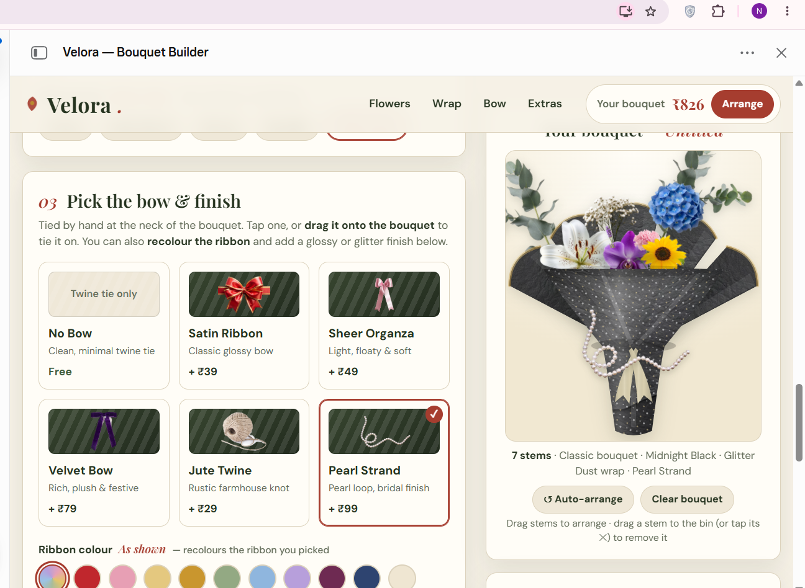
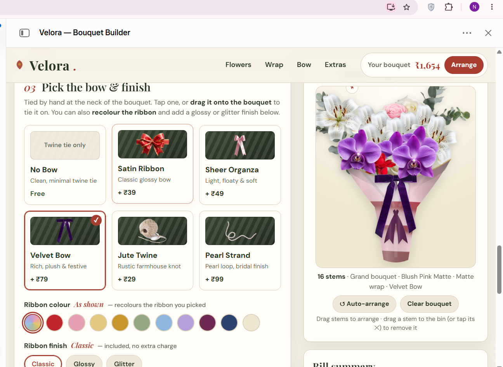

<div align="center">

# 🌸 Velora — Flowers & Bouquets

**Build your own bouquet, stem by stem — and watch it come together like a florist made it.**


*The brief: every bouquet you build should finish looking like this — flowers clustered on top, wrap fanned and folded, bow tied at the neck.*

</div>

---

## 📸 The project

Velora is a **drag-and-drop bouquet builder**. No fixed bouquets, no boring catalogue — you arrange every stem yourself, pick the wrapping paper and bow, and the price builds up live as you create.

<table>
<tr>
<td width="50%"></td>
<td width="50%"></td>
</tr>
<tr>
<td align="center"><em>Picking flowers, wraps & finishes</em></td>
<td align="center"><em>Tying the bow — style, colour & finish</em></td>
</tr>
</table>

## 🎨 What you can do

- 🌹 **12 real flowers** — roses, lilies, orchids, sunflowers & more, added stem by stem with photo cut-outs
- 🖱️ **Drag & arrange** — drag flowers into the bouquet and position them yourself; stems tuck inside the wrap automatically, and auto-arrange keeps everything inside the bouquet
- 🎁 **Wraps with colour + finish** — 10 colours and finishes like Matte, Satin Sheen, Glossy, Metallic & Glitter Dust (plus a rustic Jute Burlap)
- 🎀 **Bows for every mood** — Satin, Sheer Organza, Velvet, Gingham, Lace & Polka Dot, each recolourable
- 🍫 **Extras** — handwritten card with your message, chocolates, a teddy, or a candle
- ⚡ **One-tap presets** — Romantic Reds, Sunny Day & more, ready to customise
- 🧾 **Live itemised bill** — flowers + wrap + bow + extras + delivery (free above ₹999), updating as you build
- 💳 **Full checkout** — delivery details, date & time slot, pay by UPI, card or cash on delivery, with an order confirmation and downloadable receipt *(demo mode — connect Razorpay/Stripe to take real payments)*

## 🗂️ Project structure

| File / Folder | What's inside |
|---|---|
| `index.html` | Page markup |
| `style.css` | All styles & animations |
| `script.js` | Bouquet builder logic — flowers, wrap, bow, bill, checkout |
| `assets/` | Flower, wrap & bow photos (img-01 … img-27) |
| `pics/` | README photos & screenshots |

## 🚀 Run it locally

No build step, no dependencies — it's a static site.

```bash
git clone https://github.com/NidhiSaini27/Velora---Flowers-Bouquets.git
cd Velora---Flowers-Bouquets
```
Then open `index.html` in your browser — or serve it with any static server, e.g. `npx serve .`

## 💡 Ideas for v2

- Real payments via Razorpay (UPI + cards)
- Occasion collections — birthdays, anniversaries, weddings
- Same-day delivery slots with live tracking

## 👩‍💻 Built by

**Nidhi Saini** — BCA student @ DSEU, full-stack developer & hackathon enthusiast

[](https://github.com/NidhiSaini27)
[](https://www.linkedin.com/in/nidhi-saini-36952a324/)

---
<div align="center"><em>Made with 🌸 and way too much attention to ribbon colours.</em></div>
